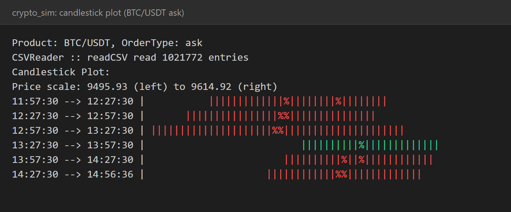
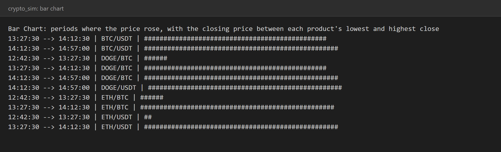

# Crypto Trading Simulator

A console crypto-exchange simulator written in **C++**. It loads an order book of about a million BTC, ETH and DOGE orders, lets you trade against it from a simulated wallet, and analyses the market with **candlestick plots** and **bar charts** drawn as coloured text in the terminal.

Built on the course's starter framework (Merkelrex). I designed and implemented the `Candlestick` and `BarChart` classes (filtering the order book, splitting it into time intervals, computing prices and drawing the plots) and their menu options.





## Menu

```
1: Print help
2: Print exchange stats
3: Make an offer
4: Make a bid
5: Print wallet
6: Print candlestick plot
7: Print Bar Chart
8: Continue
```

- **Exchange stats, offers, bids, wallet, continue:** the order book, wallet and matching engine come from the starter. You start with 10 BTC, place asks and bids, and **Continue** matches them against the market and moves to the next time frame.
- **Candlestick plot (6):** choose one of ten product and order-type combinations, for example `BTC/USDT,ask`. The orders are filtered and split into six roughly 30-minute intervals. For each interval the program computes the open, high, low and close, where the close is the volume-weighted average price, and draws one candle per interval: `|` spans the low to high range, `%` marks the open and close, green means the price rose and red means it fell. The plot is scaled between the lowest low and the highest high, and each candle opens at the previous candle's close.
- **Bar chart (7):** for each of the five products, the data is split into four roughly 45-minute intervals and the closing price of every interval where the price rose is drawn as a bar, scaled between that product's lowest and highest close.

## Data

`data/20200601.csv` holds 1,021,772 order book entries for BTC/USDT, DOGE/BTC, DOGE/USDT, ETH/BTC and ETH/USDT, recorded on 1 June 2020 between 11:57 and 14:57, and was provided with the course. The time intervals in the plots are set for this file.

## Build and run

Needs a C++17 compiler. Run the program from the repository root so it finds `data/20200601.csv`.

```bash
g++ -std=c++17 -O2 src/*.cpp -o crypto_sim
./crypto_sim
```

On Windows with Visual Studio, in a Developer Command Prompt:

```bash
cl /EHsc /O2 /std:c++17 /Fe:crypto_sim.exe src\*.cpp
crypto_sim.exe
```

Starting takes about two seconds while the order book loads. The first candlestick or bar chart takes a couple of seconds more because it reads the data once.

## Tech Stack

C++17 · STL containers and algorithms · object-oriented design

## Author

Ziad Elhussein
